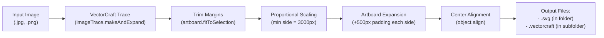

# VectorCraft Batch Trace Tool

[](https://www.python.org/)
[](LICENSE)
[](#prerequisites)

An automated batch vectorization and image post-processing tool powered by the **[VectorCraft](https://github.com/storytold/vectorcraft)** CLI engine by ArtCraft. It automatically traces raster images (JPG, PNG, etc.), removes excess whitespace, proportionally scales artwork, centers it on an expanded canvas with uniform padding, and organizes project files.

---

## Features

- **Automated Vector Tracing:** Converts raster images into clean, production-grade vector outlines via VectorCraft's image trace engine.
- **Smart Border Trimming:** Tightly crops empty margins around the illustration bounds before resizing.
- **Proportional Scaling:** Resizes artwork so its shorter side reaches a target size (default: `3000 px`), preserving the original aspect ratio without distortion.
- **Custom Canvas Margins:** Adds padding on each side (default: `500 px`), guaranteeing a final canvas of at least **`4000 px`** on the shorter side, and **`>= 4000 px`** on the longer side.
- **Project File Organization:** Automatically moves and isolates `.vectorcraft` project files into a dedicated `vectorcraft_files/` folder, keeping your output directory clean with only the final `.svg` vectors.
- **Windows Explorer Friendly:**
  - Double-click `batch_vectorize.py` or `batch_vectorize.bat` to automatically scan and process all `*.jpg`, `*.jpeg`, and `*.png` images in the directory.
  - Automatically fixes working directory path issues when launched from Windows Explorer.
  - Keeps the terminal window open upon completion so results can be verified.
- **Zero Third-Party Python Dependencies:** Built strictly using the Python Standard Library (`subprocess`, `json`, `argparse`, `tempfile`).

---

## Prerequisites

1. **Python 3.8+** installed and added to `PATH`.
2. **[VectorCraft](https://github.com/storytold/vectorcraft)** by ArtCraft (includes `vectorcraft-cli.exe`):
   - Download/install from the official repository: [storytold/vectorcraft](https://github.com/storytold/vectorcraft).
   - By default, the tool looks for the CLI in:
     - `C:\Program Files\VectorCraft\vectorcraft-cli.exe`
     - System `PATH`
     - macOS/Linux default install locations
   - You can also specify a custom binary location via the `--cli` argument.

---

## Quick Start

### 1. Windows Explorer (Double-Click)
Place `batch_vectorize.py` (or `batch_vectorize.bat`) into any folder containing your images and double-click it. It will:
1. Scan the folder for all `*.jpg` and `*.png` images.
2. Vectorize and transform each image.
3. Save output `.svg` files directly into the folder.
4. Move `.vectorcraft` project files into `vectorcraft_files/`.

### 2. Drag & Drop
Drag one or more image files (or an entire folder) directly onto `batch_vectorize.bat`.

### 3. Command Line Interface (CLI)

```bash
# Process all images in the current directory
python batch_vectorize.py

# Process a specific image
python batch_vectorize.py "illustration.jpg"

# Process all images in a target folder
python batch_vectorize.py "C:\path\to\my_images"

# Process multiple image patterns
python batch_vectorize.py *.jpg *.png
```

---

## Command Line Options

| Argument | Type | Default | Description |
| :--- | :--- | :--- | :--- |
| `inputs` | `str...` | *Current Directory* | Paths to images, folders, or glob patterns. |
| `--out-dir` | `path` | *Same as image* | Destination directory for output files. |
| `--vc-dir` | `str` | `vectorcraft_files` | Subfolder name for `.vectorcraft` project files. |
| `--min-art-size` | `float` | `3000.0` | Target size (in px) for the shorter side of the artwork. |
| `--padding` | `float` | `500.0` | Margin (in px) added to each side (`top`, `bottom`, `left`, `right`). |
| `--preset` | `str` | `Black and White Logo` | VectorCraft tracing preset (e.g. `Line Art`, `Auto Color`, `Silhouettes`). |
| `--format` | `choice` | `both` | Formats to export: `svg`, `vectorcraft`, or `both`. |
| `--png-preview` | `flag` | `False` | Also render and save a raster `.png` preview. |
| `--force-square` | `flag` | `False` | Force a 1:1 square canvas even if artwork is rectangular. |
| `--cli` | `path` | *Auto-detected* | Custom path to the `vectorcraft-cli` executable. |

### Example CLI Usages:

```bash
# Custom output directory and SVG only
python batch_vectorize.py "input_folder" --out-dir "dist/vectors" --format svg

# Larger art with 800px padding and a PNG preview
python batch_vectorize.py "logo.png" --min-art-size 4000 --padding 800 --png-preview

# Force 1:1 square canvas (e.g., 4000x4000 px)
python batch_vectorize.py "badge.jpg" --force-square
```

---

## How It Works



1. **Phase 1 (Vectorize & Trim):** VectorCraft traces the input raster using high-fidelity edge detection, then trims the artboard directly to the artwork bounds.
2. **Phase 2 (Dimension Calculation):** The script queries VectorCraft for the trimmed bounding box and calculates proportional scaling factors so the shorter side matches `--min-art-size`.
3. **Phase 3 (Artboard & Alignment):** Resizes the art with `scaleArt: true`, expands the artboard by `padding * 2` on both axes, and centers the artwork.
4. **Phase 4 (Organization):** Exports `.svg` and archives the editable `.vectorcraft` project file into the `vectorcraft_files/` directory.

---

## Directory Structure

```text
vectorcraft-batch-trace-tool/
├── batch_vectorize.py       # Main Python batch processing script
├── batch_vectorize.bat      # Windows batch launcher (double-click / drag & drop)
├── README.md                # Documentation
├── LICENSE                  # MIT License
└── .gitignore               # Git ignore configuration
```

---

## Acknowledgements & Credits

This tool is built on top of the powerful **[VectorCraft](https://github.com/storytold/vectorcraft)** vector engine created by **ArtCraft**. Special thanks to the VectorCraft team for building such a fast, versatile vector design platform and CLI automation interface.

- **VectorCraft Repository:** https://github.com/storytold/vectorcraft

---

## License

This project is licensed under the [MIT License](LICENSE).
